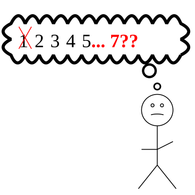

---
extensions:
  embed-svgs: true
  pygments: true
  toc: true
extra-classes:
  - blog-page--sidebar-image
tags: ["php", "php-rm", "php-rm-86"]
title: The Story of PHP 8.6.0 Release Candidate 7
---

# The Story of PHP 8.6.0 Release Candidate 7

Tomorrow, the PHP 8.6 release manager team is planning to announce the last
release candidate (RC) of PHP 8.6, PHP `8.6.0RC7`. However, release candidate 5,
[announced][rc5-announce] last week, was expected to be the last one. So, why
is an extra release candidate needed? And why is that release candidate going
to be number 7, rather than number 6?



Normally, new PHP releases have four release candidates, numbered one through
four. I [previously explained][blog-rc-1] why this year they were numbered
two through five, but the plan was still to have just four release candidates.

## ZTS and Compile-Time Offsets

When PHP is compiled in "Zend Thread Safety" (ZTS) mode, many C "global"
variables are actually tracked per thread. This includes the compiler globals,
executor globals, language scanner globals, and allocator globals, generally
accessed using the `CG`, `EG`, `LANG_SCNG`, and `AG` C macros respectively.

In PHP 8.6, a performance improvement was introduced to use compile-time offsets
to locate those globals relative to the start of the thread-specific memory.
See [php/php-src#22287][pr-22287]; a follow-up PR, [php/php-src#22595][pr-22595],
moved the language scanner globals and allocator globals to native thread storage.
Both improvements have been present since the PHP 8.6.0 beta3 tag.

The compiler and executor globals are thus laid out sequentially in memory
immediately before the thread's memory cache pointer. The compiler globals are
located directly before the memory cache pointer, and the executor globals are
located before the compiler globals, with appropriate adjustments for the types'
alignments.

In practice, this means that changing the size or layout of these types can be a
breaking ABI change, since extensions compiled with the older definition would
be trying to use outdated offsets.

When testing locally, I found that for PHP 8.6.0RC3 `ZEND_CG_OFFSET`, the start
of the compiler globals, was -624, and `ZEND_EG_OFFSET`, the start of the
executor globals, was -2992. For RC4, the compiler globals offset was unchanged,
but the executor globals offset was -3024!

## ABI numbers

To ensure that PHP extensions were compiled against the correct version of the
PHP ABI, for an extension to be loaded it must have the same values for the
module API number and the build ID that the engine has.
[See the logic in `php_load_extension()`][gh-php_load_extension]. These numbers
are updated when a new version of PHP is branched, and are used to ensure that
the extension and the PHP engine agree on the version of PHP's C ABI being used.
The build ID includes the API number and other information like whether debug
mode was enabled and whether PHP was compiled with ZTS support.

Once a new version of PHP is branched, it is expected to maintain ABI
compatibility. But, that isn't the case here - between PHP 8.6.0 RC3 and RC4,
the executor globals were relocated because they grew. The reason? A new field
was added as part of the work addressing the [PHP2Shell][php2shell]
vulnerabilities. The details can be found in
[the PHP2Shell fix for the PHP 8.6 branch][gh-d6373df], see the changes to
the `Zend/zend_globals.h` file. Both the compiler globals and the executor
globals gained a new field; for the compiler globals, the field was placed in
what was previously padding between other fields, but for the executor globals,
the new field was added to the end, increasing the size of the overall type and
moving things around.

## Impact

To understand the impact, I compared the assembly of the
`ReflectionEnum::__construct()` method implementation on RC3 and RC4. I chose
this method because it is a relatively simple method, and more importantly, it
checks whether an exception is present using `EG(exception)`. The implementation
of this method was identical in both [RC3][ref-enum-ctor-rc3] and
[RC4][ref-enum-ctor-rc4], but the assembly was different.

In RC3, [objdump][man-objdump] shows the following instructions for the check
of `EG(exception)`:

```c-objdump
  2d04c:       64 48 8b 04 25 00 00    mov    %fs:0x0,%rax
  2d053:       00 00 
  2d055:       48 2d b0 0b 00 00       sub    $0xbb0,%rax
  2d05b:       48 8b 80 f0 03 00 00    mov    0x3f0(%rax),%rax
  2d062:       48 85 c0                test   %rax,%rax
  2d065:       74 47                   je     2d0ae <zim_ReflectionEnum___construct+0x8a>
```

but in RC4, it shows

```c-objdump
  2d2d1:       64 48 8b 04 25 00 00    mov    %fs:0x0,%rax
  2d2d8:       00 00 
  2d2da:       48 2d d0 0b 00 00       sub    $0xbd0,%rax
  2d2e0:       48 8b 80 f0 03 00 00    mov    0x3f0(%rax),%rax
  2d2e7:       48 85 c0                test   %rax,%rax
  2d2ea:       74 47                   je     2d333 <zim_ReflectionEnum___construct+0x8a>
```

For those not familiar with assembly, this

1. loads the thread pointer into the `rax` register (the `%fs` segment register
is used to access thread-local storage);
2. subtracts 0xbb0 (2992) from that address in RC3, and 0xbd0 (3024) in RC4,
to locate the executor globals;
3. loads the value at offset 0x3f0 (1008) from the address in the register (this
offset is the offset of the `exception` field within the executor globals); and
4. checks if it is zero, branching accordingly.

Because the reflection extension is built into PHP, its usage of `EG(exception)`
is always going to be up to date. But, for extensions built separately, if they
were built against RC3, they would try to read the exception pointer from the
wrong offset!

## Release Candidate 6

To prevent extensions compiled against the old layout from being loaded, the API
number for PHP 8.6 needed to be bumped again. This is the change that motivated
adding an extra release candidate. You can see the version bump
[on GitHub][gh-2c5097c]. By changing the values of `ZEND_MODULE_API_NO` and
`ZEND_MODULE_BUILD_ID` (which incorporates the API number), the existing engine
logic will prevent extensions that were built against older release candidates
from being used, forcing those extensions to be rebuilt to account for the
latest changes.

In theory, a version bump was only needed for ZTS builds, since NTS builds do
not rely on the compile-time offsets to access global variables. However, having
two different version numbers would have been more confusing than bumping the
number for everyone.

Technically, an extra release candidate wasn't needed, and the version bump
could be shipped with the general availability release next week. But, that
would result in releasing code that was not tested by distribution builders,
and should be avoided where possible. After I pointed out that there was
precedent for adding an extra release candidate
([which we did last year][blog-85-rc5]), the PHP 8.6 release management team
decided to do the same this year.

Once the decision to add another release candidate was made, it opened the door
to including other changes in PHP 8.6.0 that otherwise would have had to wait
until PHP 8.6.1. For a full comparison of the changes between RC5 and RC6, you
can check the [comparison between the two tags][gh-comp-tags-56] on GitHub.

## Release Candidate 7

But wait, that explains release candidate 6. What motivated release candidate 7?

When I first drafted this blog post, the plan was indeed to publish release
candidate 6 tomorrow. But, between when RC6 was built and when it was going to
be published, the PHP 8.6 release managers got a request to include another
regression fix, [php/php-src#25286][pr-25286], in PHP 8.6.0. That PR fixed a
regression that was introduced *in RC3* when a different regression was being
fixed.

It's great to see that release candidates are being tested and that identified
issues are being reported promptly. Given that the reported regression was an
issue in an optimization, it would have resulted in PHP 8.6 producing the wrong
results on code that worked fine for PHP 8.5. As a result, the release managers
decided to include that regression fix in PHP 8.6.0.

As noted above, in theory the fix could have been included in PHP 8.6.0 without
first being included in a release candidate, but again, we prefer to avoid such
situations when possible. While security fixes are not disclosed in release
candidates to avoid leaking the details of vulnerabilities early, other changes
should go out in a release candidate.

There is precedent for building a release candidate and then not announcing it
because a separate issue prompted building a newer release candidate; see
[my writeup of PHP 8.5.6RC3 for details][blog-856-rc3]. To be clear, RC6 was
built but never announced or officially released.

In addition to the aforementioned regression fix, RC7 also includes a memory
fix, [php/php-src#25211][pr-25211]. The memory fix was considered a fix for a
security issue that only affected PHP 8.6, meaning that it could be included
without an extra release candidate. But, since there is a new release candidate,
that fix gets to be tested. For a full comparison of the changes between RC6 and
RC7, you can check the [comparison between the two tags][gh-comp-tags-67] on
GitHub.

## Looking Ahead

Fingers crossed, RC7 will indeed be the last release candidate for PHP 8.6, and
we will be able to announce the general availability of PHP 8.6 next week as
scheduled. If not, we would need to delay by another **four weeks** in order to
align with the release cycle of the maintenance branches.

I'm also giving [a presentation about PHP 8.6 changes][talk-mergephp] tomorrow
through MergePHP. I'll need to make sure that my slides are updated to
account for the changes that were just made.

[blog-85-rc5]: ./20251113-release-candidate-5
[blog-856-rc3]: ./20260430-php856-rc-3
[blog-rc-1]: ./20260923-no-php86-rc-1
[gh-2c5097c]: https://github.com/php/php-src/commit/2c5097cb73b7dbe391143fd8867080e823e4031a
[gh-d6373df]: https://github.com/php/php-src/commit/d6373dfe150a2abc999b81a5e89d5c4cb0b3b1b4
[gh-comp-tags-56]: https://github.com/php/php-src/compare/php-8.6.0RC5..php-8.6.0RC6
[gh-comp-tags-67]: https://github.com/php/php-src/compare/php-8.6.0RC6..php-8.6.0RC7
[gh-php_load_extension]: https://github.com/php/php-src/blob/php-8.6.0RC4/ext/standard/dl.c#L211
[php2shell]: https://php2shell.com
[man-objdump]: https://man7.org/linux/man-pages/man1/objdump.1.html
[pr-22287]: https://github.com/php/php-src/pull/22287
[pr-22595]: https://github.com/php/php-src/pull/22595
[pr-25211]: https://github.com/php/php-src/pull/25211
[pr-25286]: https://github.com/php/php-src/pull/25286
[rc5-announce]: https://www.php.net/archive/2026.php#2026-11-05-1
[ref-enum-ctor-rc3]: https://github.com/php/php-src/blob/php-8.6.0RC3/ext/reflection/php_reflection.c#L7636
[ref-enum-ctor-rc4]: https://github.com/php/php-src/blob/php-8.6.0RC4/ext/reflection/php_reflection.c#L7636
[talk-mergephp]: https://www.mergephp.com/meetups/2026/11/12/php-8-6-the-inside-scoop.html
